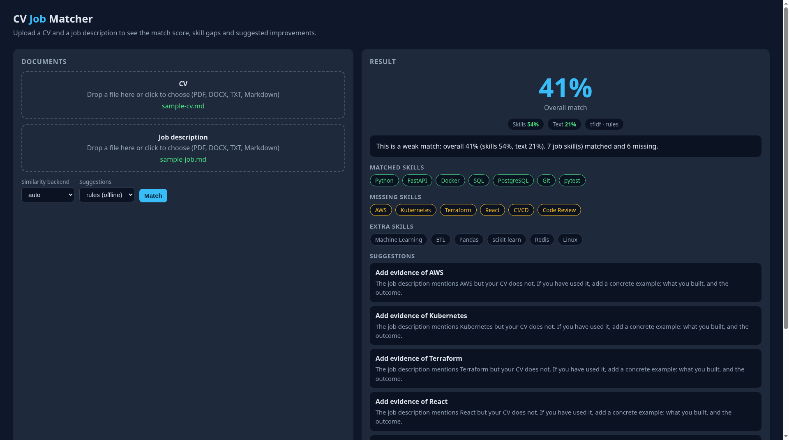

# CV Job Matcher

[](https://github.com/mzhyhan/cv-job-matcher/actions/workflows/ci.yml)
[](https://www.python.org/)
[](#testing)
[](https://mypy-lang.org/)
[](LICENSE)
[](https://github.com/astral-sh/ruff)

**Match a CV against a job description.** The library extracts text from PDF, Word
and Markdown files, finds skills in a curated taxonomy, scores the fit and
suggests how to tighten the CV. You can use it as a Python library, a
`cv-match` command or a small web app.



## Features

- **Document loading**: PDF, DOCX, TXT and Markdown, with text normalisation
  (Unicode NFKC, hyphenation repair, whitespace tidy-up and optional Markdown
  stripping).
- **Skill extraction**: a taxonomy of 153 software and AI skills, with aliases,
  punctuation variants and conservative fuzzy matching.
- **Match scoring**: an overall score from skill overlap (default 60%) and text
  similarity (40%). TF-IDF is the default backend; sentence-transformers
  embeddings are an optional extra.
- **Gap analysis**: offline, deterministic suggestions by default, or any
  OpenAI-compatible API when a key is set.
- **CLI**: `cv-match` prints scores, matched / missing / extra skills and
  suggestions, and can write JSON to stdout or a file.
- **REST API and web UI**: a FastAPI `/match` endpoint with OpenAPI docs, plus
  a drag-and-drop upload page.
- **Production-ready setup**: Google-style docstrings, strict mypy, ruff,
  pre-commit hooks, a pytest suite with a 95% coverage floor, GitHub Actions CI
  on Python 3.10–3.13, and a Docker image with a health check.

## Tech stack

Python 3.10+ · pypdf · python-docx · rapidfuzz · FastAPI · Uvicorn · pytest ·
mypy · ruff · pre-commit · Docker · GitHub Actions

Optional: `sentence-transformers` via the `[embeddings]` extra.

## Quickstart

### Local

```bash
git clone https://github.com/mzhyhan/cv-job-matcher.git
cd cv-job-matcher
python -m venv .venv && source .venv/bin/activate
pip install -e ".[web]"          # or ".[dev]" for tests and linting

cv-match docs/sample-cv.md docs/sample-job.md
uvicorn cv_matcher.web.app:app --reload   # then open http://localhost:8000
```

### Docker

```bash
docker build -t cv-job-matcher .
docker run --rm -p 8000:8000 cv-job-matcher
# Web UI: http://localhost:8000   API docs: http://localhost:8000/docs
```

The default settings run fully offline: no API key and no model download.

## Usage

### CLI

```console
$ cv-match docs/sample-cv.md docs/sample-job.md
Overall score: 41%
  Skill score: 54%
  Text score:  21% (tfidf)

Matched skills: Python, FastAPI, Docker, SQL, PostgreSQL, Git, pytest
Missing skills: AWS, Kubernetes, Terraform, React, CI/CD, Code Review
Extra skills:   Machine Learning, ETL, Pandas, scikit-learn, Redis, Linux

Summary: This is a weak match: overall 41% (skills 54%, text 21%). 7 job skill(s) matched and 6 missing.

Suggestions (provider: rules):
  1. Add evidence of AWS
     The job description mentions AWS but your CV does not. If you have used it, add a concrete example: what you built, and the outcome.
  2. Add evidence of Kubernetes
     The job description mentions Kubernetes but your CV does not. If you have used it, add a concrete example: what you built, and the outcome.
  3. Add evidence of Terraform
     ...
```

```console
$ cv-match docs/sample-cv.md docs/sample-job.md --json --provider rules
{
  "overall_score": 0.4051,
  "skill_score": 0.5385,
  "text_score": 0.205,
  "backend": "tfidf",
  "matched_skills": ["Python", "FastAPI", "Docker", "SQL", "PostgreSQL", "Git", "pytest"],
  "missing_skills": ["AWS", "Kubernetes", "Terraform", "React", "CI/CD", "Code Review"],
  "extra_skills": ["Machine Learning", "ETL", "Pandas", "scikit-learn", "Redis", "Linux"],
  "provider": "rules",
  "summary": "This is a weak match: overall 41% (skills 54%, text 21%). 7 job skill(s) matched and 6 missing.",
  "suggestions": [
    {"title": "Add evidence of AWS", "detail": "The job description mentions AWS but your CV does not. ...", "skill": "AWS", "category": "missing_skill"},
    ...
  ]
}
```

| Option | Description |
| --- | --- |
| `--json` | Machine-readable JSON instead of the text report |
| `--backend {auto,tfidf,embeddings}` | Text-similarity backend (embeddings need the optional extra) |
| `--provider {auto,rules,openai}` | Suggestion provider; `auto` uses OpenAI only if an API key is set |
| `--model`, `--api-key` | OpenAI model name and key (key also reads `OPENAI_API_KEY`) |
| `-o, --output PATH` | Write the report to a file |
| `-v, --verbose` | Log pipeline details |
| `--version` | Print the package version |

Exit codes: `0` on success, `1` if loading or analysis failed, and `2` for
usage errors such as a missing input file. `python -m cv_matcher` is equivalent
to `cv-match`.

The `openai` provider also honours `OPENAI_BASE_URL` and `OPENAI_MODEL`.

### HTTP API

After `pip install -e ".[web]"` (or from the Docker image):

- `GET /` — drag-and-drop upload page
- `GET /health` — liveness probe (`{"status": "ok", "version": "0.1.0"}`)
- `POST /match` — multipart form with `cv` and `job` files, plus optional
  `backend` and `provider` fields
- `GET /docs` — interactive OpenAPI documentation

Uploads are capped at 10 MB per file. The API returns `413` if a file is too
large, `415` for an unsupported type and `422` if a document is empty,
unreadable or an option is invalid. Scoring is done once and reused by gap
analysis.

### Python

```python
from cv_matcher import DocumentKind, analyse_gap, load_document, match_cv

cv = load_document("docs/sample-cv.md", kind=DocumentKind.CV)
job = load_document("docs/sample-job.md", kind=DocumentKind.JOB_DESCRIPTION)

result = match_cv(cv, job)
print(f"{result.overall_score:.0%}", result.backend)
print([m.name for m in result.matched_skills])
print([s.name for s in result.missing_skills])

analysis = analyse_gap(cv, job)  # rule-based unless OPENAI_API_KEY is set
print(analysis.summary)
for suggestion in analysis.suggestions:
    print(f"- {suggestion.title}: {suggestion.detail}")
```

`load_from_bytes` accepts in-memory file contents (for example an upload) and
returns the same `LoadedDocument` structure. Weights can be changed with
`ScoreWeights`; they are normalised so that they add up to one.

The library logs through the standard `logging` module (logger name
`cv_matcher`) and never prints, so it fits into any application's logging setup.

## How matching works

1. **Load and normalise.** `load_document` (or `load_from_bytes`) pulls text
   from PDF, DOCX, TXT or Markdown and applies Unicode NFKC, hyphenation repair
   and whitespace cleanup. Markdown markers can be stripped.
2. **Extract skills.** `extract_skills()` looks up a packaged taxonomy of 153
   skills (languages, ML, web, data, cloud, devops, tooling and practices).
   Matching is token-aware and case-insensitive, with stricter handling of
   ambiguous names such as `R`, `Go` and `C`, plus conservative fuzzy
   matching for close typos.
3. **Score the fit.** The skill score is the fraction of job skills also found
   on the CV. The text score is cosine similarity of the two documents, using
   a pure-Python TF-IDF implementation by default. The overall score is a
   weighted combination (default 0.6 skill / 0.4 text). If the job lists no
   extractable skills, the overall score equals the text score. `backend="auto"`
   never downloads a model; embeddings are used only when a local model is
   already available or when you pass an embedder.
4. **Suggest improvements.** `analyse_gap()` summarises the fit and returns
   targeted suggestions (missing skills, emphasis and wording). The default
   rule-based analyser is deterministic and offline. The OpenAI-compatible
   analyser is used by `provider="auto"` only when an API key is set, so a
   missing key never triggers a network call.

## Project structure

```
cv-job-matcher/
├── cv_matcher/
│   ├── loaders.py         # PDF, DOCX, TXT and Markdown extraction
│   ├── text.py            # Normalisation helpers
│   ├── skills.py          # Taxonomy loading and skill extraction
│   ├── data/skills.json   # Curated software / AI skill list
│   ├── similarity.py      # TF-IDF cosine and optional embeddings
│   ├── scoring.py         # match_cv() overall score
│   ├── analysis.py        # Gap analysis (rules + OpenAI-compatible)
│   ├── cli.py             # `cv-match` command
│   └── web/
│       ├── app.py         # FastAPI app (/, /match, /health)
│       └── static/index.html
├── tests/                 # pytest suite (offline, no model downloads)
├── docs/                  # README screenshot and sample documents
├── CHANGELOG.md
├── CONTRIBUTING.md
├── .pre-commit-config.yaml
├── .github/workflows/ci.yml
├── Dockerfile
└── pyproject.toml
```

## Testing

```bash
pip install -e ".[dev]"
pytest --cov                    # tests and doctests; fails below 95% coverage
mypy                            # strict type checking
ruff check . && ruff format --check .
pre-commit install              # run ruff, ruff-format and mypy on every commit
```

Tests stay offline: the embeddings path is covered with stubs, and the OpenAI
provider is exercised with an injected transport. CI runs lint, strict mypy and
the tests with coverage on Python 3.10, 3.11, 3.12 and 3.13, publishing a
coverage table in the run summary. It then builds the Docker image and
smoke-tests its `/health` endpoint.

## Roadmap

- [ ] Hosted live demo (Hugging Face Spaces / Render)
- [ ] Broader skill taxonomies (domain packs beyond software and AI)
- [ ] Optional export of a marked-up CV with suggested edits
- [ ] Batch matching of one CV against many job descriptions

## Contributing

See [CONTRIBUTING.md](CONTRIBUTING.md) for the development setup and checks, and
[CHANGELOG.md](CHANGELOG.md) for release notes.

## License

[MIT](LICENSE) © Mykhaylo Zhyhan
